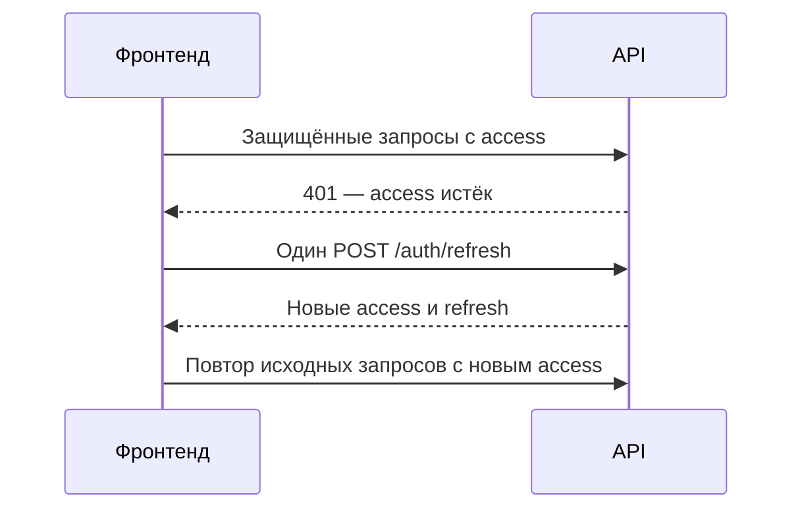
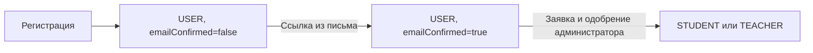

# Подключение фронтенда к API СИМУЛТЕХ

Контракт сверён с контроллерами, DTO, сервисами и интеграционными тестами бэкенда. Примеры используют вымышленные данные.

## План внедрения

1. Завести общий API-клиент с `baseURL: '/api'`; убрать прямые обращения к IP и порту `8080`.
2. Перевести регистрацию и вход на `/auth/register` и `/auth/login`, добавить хранение пары токенов, обновление сессии и выход.
3. Подключить страницы подтверждения email и сброса пароля, затем чтение и редактирование профиля.
4. Добавить состояние `USER`, формы подтверждения статуса и отображение результата проверки. Email и роль подтверждаются отдельно.
5. Подключить кабинет преподавателя через `/groups`, кабинет студента через `/groups/my` и вступление по коду.
6. Отправлять результаты игры в `/profile/scores` и использовать эти же оценки в кабинетах.
7. Пройти сценарии приёмки в конце документа.

Рабочие адреса:

| Что | Адрес |
|---|---|
| Сайт | `https://www.simultech.ru` |
| API в браузере | `/api` — относительно сайта |
| Swagger | [www.simultech.ru/swagger-ui/index.html](https://www.simultech.ru/swagger-ui/index.html) |
| OpenAPI JSON | [www.simultech.ru/api-docs](https://www.simultech.ru/api-docs) |

В таблицах далее пути указаны **без `/api`**: например, `GET /profile/me` вызывается в браузере как `GET /api/profile/me`. Не добавляйте префикс второй раз, если он уже задан в Axios.

В текущем Swagger есть неточности автоматически выведенных ответов: например, у регистрации может отображаться `200`, хотя контроллер возвращает `201`, а у некоторых методов `/groups` отсутствует успешный ответ. Для этих случаев фактические статусы и JSON приведены ниже по коду и тестам; не считайте отсутствие `200` запретом вызова.

Для локальной разработки настройте прокси `/api` на выбранный бэкенд или задайте отдельный `baseURL` через окружение сборки. Не зашивайте production IP в компоненты.

На момент подготовки инструкции сервис почтовых ссылок в работающем фронтенде уже исправлен на `/api`. Остальные известные места для замены — `AuthForm.jsx`, `ProfileInfo.jsx`, запрос профиля с `?token=` и сохранение через `/auth/profile`. Точечная правка почтового сервиса на ВМ ещё должна попасть в репозиторий фронтенда, иначе следующая сборка может вернуть старый адрес.

## Регистрация, вход и сессия

### Основные запросы

| Метод и путь | Тело запроса | Успешный ответ |
|---|---|---|
| `POST /auth/register` | `{firstName, lastName, middleName?, nickname?, email, password}` | `201 {message}` |
| `POST /auth/login` | `{email, password}` | `200 TokenResponse` |
| `POST /auth/refresh` | `{refreshToken}` | `200 TokenResponse`, **новая пара** |
| `POST /auth/logout` | `{refreshToken}` | `200 {message}` |
| `GET /users/me` | — | `200 MeResponse` |

Для регистрации обязательны имя, фамилия, email и пароль длиной **не менее 6 символов**. Отчество и никнейм необязательны. Повторный email даёт `400`. Регистрация не возвращает токены — после неё выполните вход отдельно, если нужен автоматический переход в профиль.

Пример входа:

```js
const { data } = await publicApi.post('/auth/login', {
  email: 'student@example.test',
  password: passwordFromForm,
});
setSession(data);
```

`TokenResponse` имеет следующий вид; значения токенов здесь только обозначения:

```json
{
  "accessToken": "<access-token>",
  "refreshToken": "<refresh-token>",
  "tokenType": "Bearer",
  "expiresInMs": 900000
}
```

Access-токен действует 15 минут, refresh-токен — 30 дней. `expiresInMs` — миллисекунды. Refresh передаётся в JSON, а access — только в заголовке:

```http
Authorization: Bearer <access-token>
```

API не устанавливает cookie с сессией. Выберите способ хранения токенов в приложении явно. Пример ниже хранит их в памяти и после перезагрузки страницы требует входа. Если нужна сохраняемая сессия, подключите её хранение к тому же модулю, не дублируйте токены в компонентах. Не помещайте их в URL и логи.

### Обновление токена и выход

При refresh старый refresh-токен отзывается. Сохраняйте **оба новых токена**. Повторное использование старого, истёкшего или неизвестного refresh даёт `400`, а не `401`.

Если несколько запросов одновременно получили `401`, они должны ждать **один общий refresh** — single flight. Иначе один запрос использует refresh первым, а остальные получат `400`. Каждый исходный запрос повторяется максимум один раз. `403` означает проблему прав и не запускает refresh.



Ниже пример отдельного модуля `api.js` для Axios. `publicApi` не добавляет access-токен и не имеет автоматического refresh; через него вызываются вход, регистрация, операции почтовых ссылок, refresh и logout.

```js
import axios from 'axios';

export const publicApi = axios.create({ baseURL: '/api', timeout: 20000 });
export const api = axios.create({ baseURL: '/api', timeout: 20000 });

let session = null;
let sessionVersion = 0;
let refreshTask = null;

export function setSession(pair) {
  sessionVersion += 1;
  session = pair;
}

export function clearSession() {
  sessionVersion += 1;
  session = null;
  // Здесь также очистить хранилище, профиль и кэш данных кабинета.
}

function refreshOnce(version) {
  if (refreshTask?.version === version) return refreshTask.promise;
  const refreshToken = session.refreshToken;
  const task = { version };
  task.promise = publicApi.post('/auth/refresh', { refreshToken })
    .then(({ data }) => {
      // Выход или новый вход во время refresh не должны вернуть старую сессию.
      if (sessionVersion !== version) throw new Error('Session changed');
      session = data;
    })
    .finally(() => {
      if (refreshTask === task) refreshTask = null;
    });
  refreshTask = task;
  return task.promise;
}

api.interceptors.request.use((config) => {
  config._sessionVersion = sessionVersion;
  config._accessToken = session?.accessToken;
  if (session?.accessToken) {
    config.headers.set('Authorization', `Bearer ${session.accessToken}`);
  } else {
    config.headers.delete('Authorization');
  }
  return config;
});

api.interceptors.response.use((response) => response, async (error) => {
  const request = error.config;
  if (error.response?.status !== 401 || !request) throw error;
  // Ответы от уже завершённой сессии не меняют текущую.
  if (request._sessionVersion !== sessionVersion) throw error;
  if (request._retried || !session?.refreshToken) {
    clearSession();
    throw error; // UI показывает форму входа; бесконечного повтора нет.
  }
  request._retried = true;
  const version = sessionVersion;
  try {
    // Если другой запрос уже обновил пару, используем её без второго refresh.
    if (request._accessToken === session.accessToken) await refreshOnce(version);
    if (version !== sessionVersion || !session) throw new Error('Session changed');
    return api(request);
  } catch (refreshError) {
    if (version === sessionVersion) clearSession();
    throw refreshError;
  }
});

export async function logout() {
  const refreshToken = session?.refreshToken;
  clearSession(); // Локальный выход выполняется и при недоступном сервере.
  if (refreshToken) await publicApi.post('/auth/logout', { refreshToken });
}
```

Это пример для одной вкладки. Если токены общие между вкладками, синхронизируйте refresh и выход между ними, иначе ротация может конфликтовать. При сетевой ошибке logout локальная сессия уже очищена; сообщите о недоступности сервера без восстановления старой сессии.

Logout отзывает **все refresh-токены пользователя**, включая другие сессии. Непустой неизвестный или истёкший refresh при logout даёт `200`: операция идемпотентна. Отсутствующее или пустое поле, некорректный JSON — `400`. Уже выданный access может действовать до конца своих 15 минут, поэтому frontend при выходе всегда очищает его самостоятельно.

Не добавляйте устаревший Bearer к публичным запросам: фильтр проверяет переданный токен даже на публичном маршруте и может вернуть `401` до обработки запроса.

## Email и роли — разные состояния



Вход доступен до подтверждения email. Подтверждение email **не назначает STUDENT**. Новый пользователь остаётся `USER`, пока администратор не одобрит отдельную заявку на роль. Также существует `ADMIN`.

Показывайте интерфейс по `role` из `/users/me` и отдельно баннер подтверждения по `emailConfirmed`. Не вычисляйте роль из наличия подтверждённой почты. Не заменяйте её константой `STUDENT` после регистрации. Доступ на сервере проверяется независимо от видимости кнопок.

`GET /users/me` и `GET /auth/me` возвращают одинаковый `MeResponse`:

```json
{
  "id": 42,
  "email": "student@example.test",
  "nickname": "network_student",
  "firstName": "Анна",
  "lastName": "Примерова",
  "middleName": null,
  "role": "USER",
  "emailConfirmed": false
}
```

Для нового кабинета `GET /profile/me` возвращает **другой DTO**:

```json
{
  "id": 42,
  "role": "STUDENT",
  "avatarUrl": null,
  "firstName": "Анна",
  "lastName": "Примерова",
  "middleName": null,
  "email": "student@example.test"
}
```

Здесь нет `nickname` и `emailConfirmed`. `avatarUrl` сейчас всегда `null`; загрузка аватара не реализована. `id` — публичный ID пользователя, он же `studentId` для новых `/groups`.

### Подтверждение статуса

| Метод и путь | Назначение |
|---|---|
| `POST /verification/student` | JSON-заявка на роль студента; `201` |
| `POST /profile/teacher-request` | Заявка преподавателя с документом; `200` |
| `GET /verification/status` | Массив своих заявок, новые сверху |

Обе заявки требуют подтверждённой почты и роли `USER`. Минимальное тело студенческой заявки: `{"fullName":"Примерова Анна"}`. Остальные поля: `birthYear`, `phone`, `universityId`, `faculty`, `speciality`, `direction`, `course`, `degree`; их полный контракт есть в Swagger. Заполняйте их по согласованной форме.

Статусы: `PENDING`, `APPROVED`, `REJECTED`; тип заявки — `STUDENT` или `TEACHER`. Пример ответа `/verification/status`:

```json
[
  {
    "id": 12,
    "requestType": "STUDENT",
    "status": "PENDING",
    "comment": null,
    "createdAt": "2026-10-25T10:00:00Z",
    "reviewedAt": null
  }
]
```

Пока есть любая `PENDING`-заявка, другая заявка даёт `409`. После назначения роли повторная заявка тоже даёт `409`. Не предлагайте пользователю `STUDENT` обычную смену на `TEACHER`: текущий сценарий допускает переходы только из `USER`. Существующий профиль другого типа также мешает подаче заявки, даже если прежняя заявка отклонена.

После рассмотрения перечитайте `/verification/status` и `/users/me`. Для получения новой роли перелогин не требуется: сервер на каждом запросе берёт актуальные права из БД. Для ожидания результата можно использовать кнопку обновления или опрос только пока страница открыта.

## Страницы из писем

В письмах приходят адреса **фронтенда**:

- `/confirm-email?token=...`
- `/reset-password?token=...`

Оба React-маршрута должны открываться напрямую, в том числе у неавторизованного пользователя. Токен из письма — не access-токен, не сохраняйте его в сессию.

### Подтверждение email

Прочитайте `token` из query через `URLSearchParams` и выполните публичный запрос:

```js
const token = new URLSearchParams(window.location.search).get('token');
if (!token) throw new Error('В ссылке отсутствует токен подтверждения');
await publicApi.post('/auth/confirm-email', { token });
```

Успех — `200 {"message":"Email подтверждён"}`. После него покажите результат и ссылку в профиль/на вход; для текущей сессии обновите `/users/me`.

Запускайте запрос один раз на действие. В частности, учтите повторный вызов эффектов в React StrictMode: используйте общий запрос с дедупликацией или кнопку подтверждения. Ссылка одноразовая, второй успешный запрос уже невозможен.

### Сброс пароля

`POST /auth/forgot-password {email}` возвращает `200 {message}` с одинаковым публичным текстом независимо от существования адреса. Не показывайте «пользователь найден» на основании этого ответа. Успешный ответ также не является подтверждением фактической доставки письма.

Страница `/reset-password` читает `token`, просит новый пароль и по отправке формы вызывает:

```js
await publicApi.post('/auth/reset-password', {
  token: tokenFromQuery,
  newPassword: passwordFromForm,
});
```

После `200` очистите старую сессию и предложите войти с новым паролем. Сброс отзывает все refresh-токены пользователя. Не отправляйте запрос сразу при открытии страницы: требуется ввод нового пароля.

Для повторного письма подтверждения: `POST /auth/resend-confirmation {email}` → `200 {message}`. Ответ одинаков для неизвестного адреса, уже подтверждённого и ожидающего подтверждения пользователя.

Ссылки подтверждения и сброса действуют 24 часа, используются один раз. Новое письмо того же типа отменяет прежнюю активную ссылку. Возможные ошибки:

| Статус | Что означает для ссылок |
|---|---|
| `400` | Пустой токен, неверный тип, срок вышел или ссылка уже использована |
| `404` | Токен не найден; также возможен после очистки старых токенов |

Не сводите сетевую ошибку, `500` и все эти случаи к одному сообщению «ссылка устарела». Для `400/404` предложите повторное письмо, для отсутствия сети — повторить запрос позже. После завершения операции уберите токен из адресной строки, например `history.replaceState`, чтобы он не оставался в копируемом адресе.

## Редактирование профиля

Все операции ниже требуют Bearer:

| Метод и путь | Тело | Ответ |
|---|---|---|
| `PUT /users/profile` | `{firstName?, lastName?, middleName?, nickname?}` | `200 MeResponse` |
| `PUT /users/email` | `{newEmail, password}` | `200 {message}` |
| `POST /auth/change-password` | `{oldPassword, newPassword}` | `200 {message}` |

Пример:

```js
const { data: me } = await api.put('/users/profile', {
  firstName: 'Анна',
  lastName: 'Примерова',
  middleName: '',
  nickname: 'network_student',
});
```

Незаданные поля не меняются. Пустые имя/фамилия игнорируются; пустые строки для отчества и никнейма сохраняются, ими можно очистить эти поля. Не отправляйте `email` и `password` в обновление профиля — для них существуют отдельные операции. Неизвестное поле не означает, что сервер его сохранил.

Смена email требует текущий пароль, сбрасывает `emailConfirmed` и отправляет письмо на новый адрес. Перечитайте `/users/me` и покажите подтверждение нового адреса. Неверный пароль, занятый email или совпадение нового с текущим дают `400`.

Смена пароля требует текущий пароль, отзывает все refresh-токены и старые ссылки сброса. После успеха очистите сессию и предложите вход заново. Новый пароль — минимум 6 символов; неверный текущий пароль даёт `400`.

## Кабинет преподавателя: новые `/groups`

Все методы этой таблицы доступны только `TEACHER`; `ADMIN` автоматически не считается преподавателем. Отображаются и изменяются только собственные группы.

| Метод и путь | Тело / ответ |
|---|---|
| `GET /groups` | `200 [{id, name, organization, studentsCount}]` |
| `POST /groups` | `{name, organization}` → `201` объект списка |
| `GET /groups/{id}` | `200 {id, name, organization, inviteCode, students}` |
| `PUT /groups/{id}` | `{name, organization}` → `200` объект списка |
| `POST /groups/{id}/students` | `{studentId}` → `200 {message}` |
| `DELETE /groups/{id}/students/{studentId}` | `200 {message}` |

`name` и `organization` обязательны, непустые, до 255 символов. `organization` — юридическое название вуза текстом, а не ID из справочника. Для старой группы организация может быть `null`, если её невозможно получить из справочника.

Пример ответа группы:

```json
{
  "id": 7,
  "name": "КС-21",
  "organization": "Учебный университет",
  "inviteCode": "<invite-code>",
  "students": [
    {
      "id": 42,
      "lastName": "Примерова",
      "firstName": "Анна",
      "scores": [10, 8, null, null, null, null, null, null, null, null, null]
    }
  ]
}
```

Для добавления и удаления используется ID **пользователя** из `/profile/me`, то есть `users.id`. Это же значение приходит как `students[].id`. Повторное добавление не создаёт дубликат. Добавление пользователя с ролью не `STUDENT` даёт `409`; неизвестный ID — `404`. Чужая группа тоже даёт `404`.

Код приглашения постоянный и возвращается в деталях группы. Фронтенд сам формирует ссылку, например `/join-group/<inviteCode>`: такой маршрут нужно создать в React, сервер не возвращает готовый frontend URL. После входа студент отправляет код в API. `GET` по ссылке не должен менять состав группы автоматически без понятного действия «Вступить».

В новых `/groups` нет эндпоинта удаления самой группы. Не рисуйте для него рабочую кнопку на основании этой таблицы.

## Кабинет студента

| Метод и путь | Ответ |
|---|---|
| `POST /groups/join/{inviteCode}` | `200` объект группы с преподавателем |
| `GET /groups/my` | `200` массив таких объектов |

Оба метода требуют роль `STUDENT`. Повторное вступление допустимо. Неизвестный код даёт `404`, несовместимый вуз для старой группы с `universityId` — `409`.

```json
[
  {
    "id": 7,
    "name": "КС-21",
    "organization": "Учебный университет",
    "teacher": {
      "lastName": "Примеров",
      "firstName": "Сергей",
      "middleName": null
    }
  }
]
```

Сохраняйте код приглашения на время входа, если пользователь открыл ссылку без сессии. Пользователю `USER` сначала покажите необходимость подтверждения статуса; успешный вход сам по себе не разрешает вступление.

## Оценки и игра

`GET /profile/scores` возвращает массив **ровно из 11 элементов**: индекс `0` — обучение, индексы `1–10` — уровни. Метод доступен любому авторизованному пользователю, отдельная роль для него не требуется.

```json
[10, 0, 8, null, null, null, null, null, null, null, null]
```

`null` означает отсутствие результата; `0` — пройдено с нулевым баллом. Для отображения используйте `score === null ? '—' : score`, не `score || '—'`.

Игра сохраняет результат текущего пользователя:

```js
const { data: scores } = await api.post('/profile/scores', {
  level: 2,
  score: 8,
});
```

Оба значения обязательны, **целые числа от 0 до 10 включительно**. Дробные, строковые невалидные и выходящие за диапазон значения не отправляйте; сервер проверяет контракт. В ответе — актуальный массив из 11 значений. При старом результате `8` новый `5` не уменьшит оценку, новый `10` заменит её. Не обещайте пользователю перезапись лучшего результата меньшим.

После успешного ответа обновите локальное состояние оценок. При сетевой ошибке покажите, что сохранение не подтверждено; повтор с тем же результатом допустим. Преподаватель получает те же значения в `GET /groups/{id}` → `students[].scores`.

Это отдельные результаты игры, они не вычисляются из старого `/sync/progress` и не привязаны к порядку `/labs`. Игра должна явно отправлять `POST /profile/scores`, иначе новые оценки не появятся. Для Unity WebGL удобно передавать `level` и `score` в JS-обёртку, которая уже использует общий авторизованный клиент; не встраивайте в игру отдельные учётные данные.

## Заявка преподавателя с документом

`POST /profile/teacher-request` принимает `multipart/form-data`:

| Поле | Ограничение |
|---|---|
| `fullName` | ФИО, непустая строка, до 255 символов |
| `organization` | Юридическое название вуза, непустая строка, до 255 символов |
| `file` | Один непустой файл PDF, JPG/JPEG, PNG или DOC, до `5 × 1024 × 1024` байт |

DOCX сейчас не поддерживается. Проверяются расширение и сигнатура файла — переименование произвольного файла в `.pdf` не подойдёт.

```js
const form = new FormData();
form.append('fullName', fullNameFromForm);
form.append('organization', organizationFromForm);
form.append('file', selectedFile);
await api.post('/profile/teacher-request', form);
```

**Не выставляйте `Content-Type` вручную**: браузер и Axios добавят multipart boundary. Не задавайте глобально `Content-Type: application/json` для всех запросов клиента. Для выбора файла можно использовать `accept=".pdf,.jpg,.jpeg,.png,.doc"`, но окончательное решение принимает сервер.

Успех: `200 {"message":"Заявка отправлена на рассмотрение"}`. Роль остаётся `USER`, статус заявки становится `PENDING`. После отправки перечитайте `/verification/status` и заблокируйте повторную отправку ожидающей заявки.

Требуется `USER` с подтверждённым email. Неподтверждённая почта — `403`, уже назначенная роль или другая ожидающая заявка — `409`. Недопустимый файл/поля — `400`; превышение лимита загрузки может дать `413` на HTTP-слое или `400` при проверке файла сервисом. Сбой отправки письма — `503`, заявка откатывается, пользователь может повторить отправку.

Документ передаётся вложением в письмо получателю заявки. Фронтенд не загружает его отдельно в S3 и не получает `fileUrl`: такого поля и отдельного файлового API здесь нет.

JSON-маршрут `/verification/teacher` тоже существует, но он не принимает файл. Для кнопки «Получить статус преподавателя» с выпиской используйте именно `/profile/teacher-request`.

## Быстрая проверка через curl

Подставьте access-токен своего тестового пользователя вместо `<access-token>`. У операции с файлом нужен `USER` с подтверждённым email; у групп — `TEACHER`. Примеры не содержат действующих токенов или паролей.

```bash
# Профиль — access передаётся заголовком, query token не нужен.
curl --fail-with-body 'https://www.simultech.ru/api/profile/me' \
  -H 'Authorization: Bearer <access-token>'

# Результат игры текущего пользователя.
curl --fail-with-body 'https://www.simultech.ru/api/profile/scores' \
  -H 'Authorization: Bearer <access-token>' \
  -H 'Content-Type: application/json' \
  --data '{"level":2,"score":8}'

# Файл отправляется в том же запросе, multipart boundary выставит curl.
curl --fail-with-body 'https://www.simultech.ru/api/profile/teacher-request' \
  -H 'Authorization: Bearer <access-token>' \
  -F 'fullName=Примеров Сергей' \
  -F 'organization=Учебный университет' \
  -F 'file=@./employment.pdf'
```

## Ошибки и состояния интерфейса

Новые REST-операции обычно возвращают `ApiError`:

```json
{
  "status": 400,
  "error": "Bad Request",
  "message": "Некорректное тело запроса",
  "timestamp": "2026-10-25T10:00:00Z"
}
```

| HTTP | Что делать на фронте |
|---|---|
| `400` | Показать ошибку полей/операции. Для refresh — завершить сессию; для email-ссылок предложить новое письмо |
| `401` | На защищённом запросе один refresh и один повтор; на login — неверные учётные данные |
| `403` | Показать отсутствие прав или необходимость подтвердить email; refresh не поможет |
| `404` | Ресурс/приглашение/токен не найден, либо группа не принадлежит преподавателю |
| `409` | Конфликт состояния: ожидающая заявка, уже назначенная роль, неподходящий студент/вуз |
| `413` | Файл/запрос слишком большой |
| `503` | Не удалось отправить заявку преподавателя по почте; можно повторить позже |
| `500` | Ошибка сервера; сохранить введённые данные формы и дать повторить позже |

Не привязывайте бизнес-логику к точному русскому `message`: отдельного стабильного кода ошибки в DTO пока нет. Используйте HTTP-статус и контекст операции, сообщение показывайте пользователю как текст. Ошибка от nginx, проблема сети или таймаут может не иметь JSON-тела — предусмотрите запасное сообщение.

Для отправляемых форм нужны состояния «отправляется», «успех», «ошибка» и блокировка повторного клика. Для списков различайте пустой результат `[]` и ошибку загрузки. Не показывайте `401/403` как пустую группу или нулевые оценки.

## Переход со старых запросов

| Старое обращение | Что использовать в новом фронтенде |
|---|---|
| Прямой `http://<IP>:8080` | `baseURL: '/api'` |
| `POST /auth/sign-up` → текст, `200` | `POST /auth/register` → `{message}`, `201` |
| `POST /auth/sign-in` → JWT **строкой** | `POST /auth/login` → JSON с access и refresh |
| `GET /profile/me?token=...` | `GET /profile/me` с `Authorization: Bearer ...` |
| `PUT /auth/profile` | `PUT /users/profile`; email и пароль отдельными операциями |
| `POST /auth/forgot` | `POST /auth/forgot-password` |
| `POST /auth/reset` | `POST /auth/reset-password` |
| `GET /auth/confirm?token=...` | Для React-страницы удобнее `POST /auth/confirm-email {token}` |

Legacy `sign-in`, `sign-up`, `forgot`, `reset` пока поддерживаются, но помечены устаревшими в Swagger. Не смешивайте обработчики `sign-in` и `login`: строку JWT нельзя читать как `data.accessToken`. Неверные credentials в legacy `sign-in` дают пустой `401`, в новом login — `ApiError`.

В Swagger также есть старая LMS: `/teacher/groups`, `/teacher/students`, `/student/invitations`, `/labs`, `/sync/progress` и другие маршруты. Для описанных здесь кабинетов используйте **новые `/groups`**. В старой LMS другое тело создания (`groupName`, `universityId`), внутренние ID профилей студентов и персональные приглашения с отдельным принятием/отклонением. Их нельзя подставлять вместо `users.id` или `inviteCode` из нового API. Подробности старой LMS вынесены в Swagger.

## Проверка перед передачей

### Общая сессия и почта

- Регистрация даёт `201`, вход — JSON-пару токенов; до подтверждения почты вход работает и роль `USER`.
- Прямое открытие письма подтверждения приводит к успешному `POST /auth/confirm-email`, роль остаётся `USER`, `emailConfirmed` становится `true`.
- Повторный/просроченный токен показывает понятное состояние, сетевой сбой не называется просроченной ссылкой.
- Запрос сброса и новое письмо подтверждения показывают нейтральный ответ; установка нового пароля работает, старый пароль больше не подходит.
- Несколько параллельных `401` вызывают один refresh. Новая пара сохраняется, каждый запрос повторяется максимум один раз. Отказ refresh завершает сессию без цикла.
- Logout очищает профиль, токены и данные кабинета даже при ошибке сети. Поздний ответ refresh не восстанавливает сессию.
- ФИО и никнейм сохраняются отдельно от email и пароля; `null` и пустое отчество отображаются корректно.

### Студент

- Подтверждённый `USER` подаёт заявку студента, видит `PENDING`; после одобрения администратором и обновления профиля видит `STUDENT`.
- `STUDENT` вступает по коду, видит группу и преподавателя. Повторное вступление не дублирует группу; неверный код показывает ошибку.
- Игра сохраняет обучение и уровень; `0` отображается нулём, непройденный уровень — прочерком. Меньший результат не ухудшает лучший.
- Группы и оценки остаются доступны после обновления access-токена.

### Преподаватель

- Подтверждённый `USER` отправляет валидный документ до 5 МиБ, видит ожидающую заявку. Неподдерживаемый/большой файл отклоняется понятным сообщением.
- Администратор рассматривает заявку через `/admin/verifications/{id}/approve` или `/reject` (Swagger, учётная запись `ADMIN`). После одобрения профиль показывает `TEACHER`.
- Преподаватель создаёт группу, меняет её название/организацию, копирует приглашение.
- Добавляет студента по его **публичному ID**, видит результаты игры, удаляет студента. Повторное добавление не создаёт вторую запись.
- Чужая группа и попытки работать под неподходящей ролью не раскрывают данные.

Админские маршруты, справочники, лицензии и отчёты не обязательны для первого подключения кабинетов; их полный контракт доступен в Swagger.
