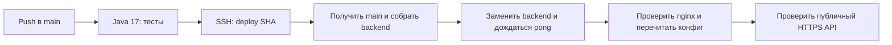

# Автодеплой бэкенда на существующую ВМ

Workflow: [`.github/workflows/backend.yml`](../.github/workflows/backend.yml).
Серверный скрипт: [`deploy-vm.sh`](deploy-vm.sh).



Pull request в `main` запускает только тесты. Push в `main` и ручной запуск
workflow на `main` после успешных тестов обновляют ВМ автоматически.
Дополнительного подтверждения для каждого такого деплоя не будет: именно
это поведение нужно согласовать при первоначальном подключении.

Работающий деплой не отменяется следующим пушем. На сервере `flock` исключает
параллельное обновление. Если ожидаемый SHA уже не соответствует `origin/main`,
устаревший запуск пропускается; новый запуск получит актуальную версию.

## Что обновляется

Скрипт работает с `/root/net-genius/backend`, веткой `main` и **корневым**
`/root/net-genius/docker-compose.yml`. Compose project — `net-genius`.

1. Проверяет, что в отслеживаемых файлах бэкенда нет локальных изменений.
2. Получает `main`, проверяет SHA и обновляет checkout только fast-forward.
3. Проверяет Compose без вывода паролей и выполняет `build backend`.
4. После успешной сборки выполняет `up --detach --no-deps --no-build backend`.
5. Ждёт `pong` внутри нового контейнера.
6. Выполняет `nginx -t` и `nginx -s reload` в существующем контейнере nginx:
   nginx должен заново определить IP нового контейнера бэкенда.
7. Проверяет `https://www.simultech.ru/api/auth/ping`.

Обычный `git pull` и сборка не останавливают старый контейнер. Короткий перерыв
API возникает при его замене. Ошибка сборки останавливает деплой до замены.

Фронтенд и его сборка не изменяются. Контейнер базы и volume
`net-genius_postgres_data` сохраняются. `.env` остаётся на ВМ; SMTP, JWT,
пароли администратора и БД не нужно переносить в GitHub.

Схему БД, как и при ручном запуске, обновляет приложение при старте.
Резервные копии и дампы по решению пользователя не создаются. Скрипт не делает
`reset`, `clean`, очистку Docker или автоматический откат БД. При ошибке job
завершается с ошибкой; восстановление зависит от её причины.

## Однократная настройка

Подготовить файлы можно заранее. Установка скрипта и SSH-ключа на ВМ требует
подтверждения пользователя. Сначала подключите сервер и секреты, затем
сливайте workflow в `main`, чтобы первый автоматический запуск уже имел доступ.

### 1. Отдельный SSH-ключ для Actions

Сгенерируйте Ed25519-ключ без passphrase **вне Git-репозитория**:

```bash
ssh-keygen -t ed25519 -N '' -C 'github-actions simulteh/backend' \
  -f "$HOME/.ssh/simulteh-actions"
```

Приватная часть будет храниться в GitHub Actions secret, публичная — на ВМ.
Обычный пароль root для Actions не используется.

### 2. Установить проверенный скрипт на ВМ

Передайте `deploy/deploy-vm.sh` из подготовленной версии репозитория в
`/usr/local/sbin/simulteh-deploy`. На сервере файл должен принадлежать root
и иметь права `0755`:

```bash
chown root:root /usr/local/sbin/simulteh-deploy
chmod 0755 /usr/local/sbin/simulteh-deploy
bash -n /usr/local/sbin/simulteh-deploy
```

Это отдельная проверенная копия скрипта, а не ссылка на файл репозитория.
Если меняется логика `deploy-vm.sh`, установленную копию нужно обновить
отдельно. Это не требуется для обычных изменений кода приложения.

### 3. Разрешить ключу только деплой

В `/root/.ssh/authorized_keys` добавьте **отдельную строку**, сохранив
существующие ключи:

```text
restrict,command="/usr/local/sbin/simulteh-deploy" ssh-ed25519 <PUBLIC_KEY> github-actions simulteh/backend
```

`<PUBLIC_KEY>` — публичная часть нового ключа, не приватный ключ.
Каталог `.ssh` должен иметь права `0700`, файл `authorized_keys` — `0600`.

Этому ключу разрешена команда строго вида `deploy <40-символьный SHA>`.
Произвольная shell-команда, PTY и forwarding не разрешаются. Сам скрипт
проверяет, что SHA соответствует текущему `main`. Так Actions получает
доступ для обновления приложения через существующий root/Docker стек.

### 4. Секреты репозитория GitHub

Откройте **Settings → Secrets and variables → Actions → Repository secrets**
в `simulteh/backend` и добавьте:

| Secret | Содержимое |
|---|---|
| `DEPLOY_SSH_KEY` | Весь приватный ключ, включая BEGIN/END и переводы строк |
| `DEPLOY_KNOWN_HOSTS` | Проверенная запись SSH host key для целевой ВМ |

Для known hosts используйте ключ сервера, с которым уже проверено обычное
SSH-подключение. Например, существующую запись можно получить командой
`ssh-keygen -F 212.67.12.82`; служебные строки, начинающиеся с `#`, в secret
не нужны. Не отключайте `StrictHostKeyChecking`: workflow проверяет сервер
по этой записи.

Необязательные **Repository variables**:

| Variable | По умолчанию |
|---|---|
| `DEPLOY_HOST` | `212.67.12.82` — существующая ВМ |
| `DEPLOY_USER` | `root` |
| `DEPLOY_PORT` | `22` |

При нестандартном порте запись known hosts должна соответствовать
`[host]:port`. Приватный ключ не добавляется в variables, файлы репозитория
или текст workflow.

## Первый запуск и проверка

После подключения ключа и секретов слейте изменения в `main`. Откройте
**Actions → Backend CI and deploy**. Ожидаются успешные jobs **Tests** и
**Deploy to VM**, последняя строка серверного скрипта —
`Deployment succeeded: <SHA>`.

Повторный запуск доступен через **Run workflow**, выбирайте ветку `main`.
Запуск из другой ветки не деплоит её на сервер.

На ВМ можно сверить результат без вывода секретов:

```bash
cd /root/net-genius
git -C backend log -1 --oneline
docker compose ps
curl --fail --silent --show-error https://www.simultech.ru/api/auth/ping
```

Для доверенного локального администратора доступен ручной запуск установленного
скрипта с полным SHA. Это реальный деплой с теми же последствиями:

```bash
SIMULTEH_DEPLOY_SHA='FULL_MAIN_COMMIT_SHA'
/usr/local/sbin/simulteh-deploy "$SIMULTEH_DEPLOY_SHA"
```

## Если job завершился с ошибкой

- **Tests:** исправьте тесты/сборку; доступ к ВМ ещё не использовался.
- **Missing secret / Permission denied:** проверьте secrets, публичный ключ,
  владельца и права SSH-файлов. Штатный вход администратора не изменяется.
- **Host key verification failed:** проверьте ключ сервера, а не отключайте проверку.
- **Local changes / diverged main:** разберите правки на ВМ. Автодеплой не удаляет их.
- **Build failed:** старый контейнер продолжает работать.
- **Readiness / nginx / HTTPS failed:** проверьте состояние контейнеров и логи
  на ВМ. Скрипт не печатает целиком application logs в публичный job.
- **Skipping this run:** за время ожидания появился другой `main`; проверяйте
  запуск для более нового коммита.

Проверки скрипта без Docker и SSH:

```bash
bash -n deploy/deploy-vm.sh
python3 -B -m unittest discover -s deploy/tests -p 'test_*.py' -v
```

Официальные справки: [события workflow](https://docs.github.com/en/actions/reference/workflows-and-actions/events-that-trigger-workflows),
[последовательность запусков](https://docs.github.com/en/actions/how-tos/write-workflows/choose-when-workflows-run/control-workflow-concurrency),
[secrets](https://docs.github.com/en/actions/how-tos/write-workflows/choose-what-workflows-do/use-secrets).
